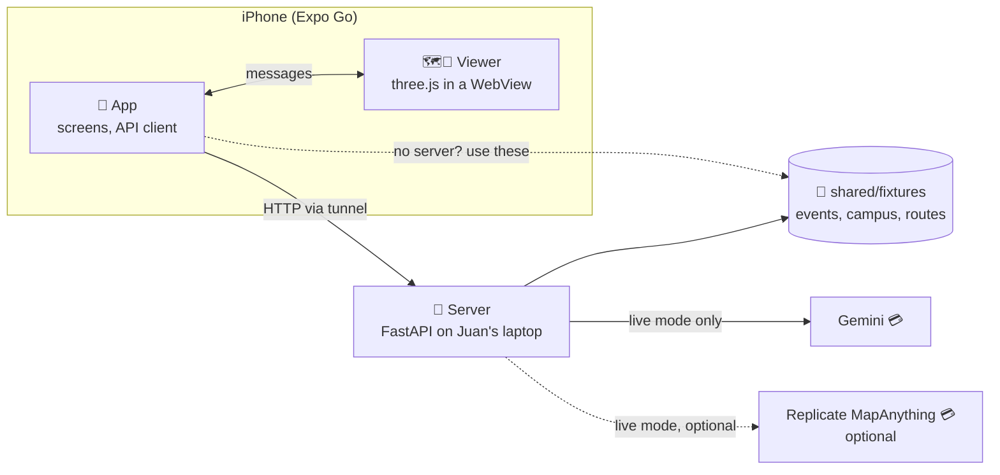
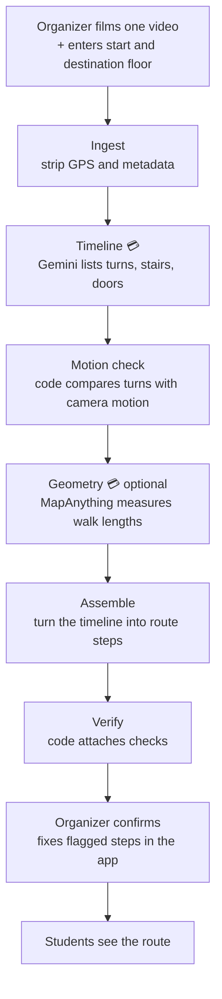
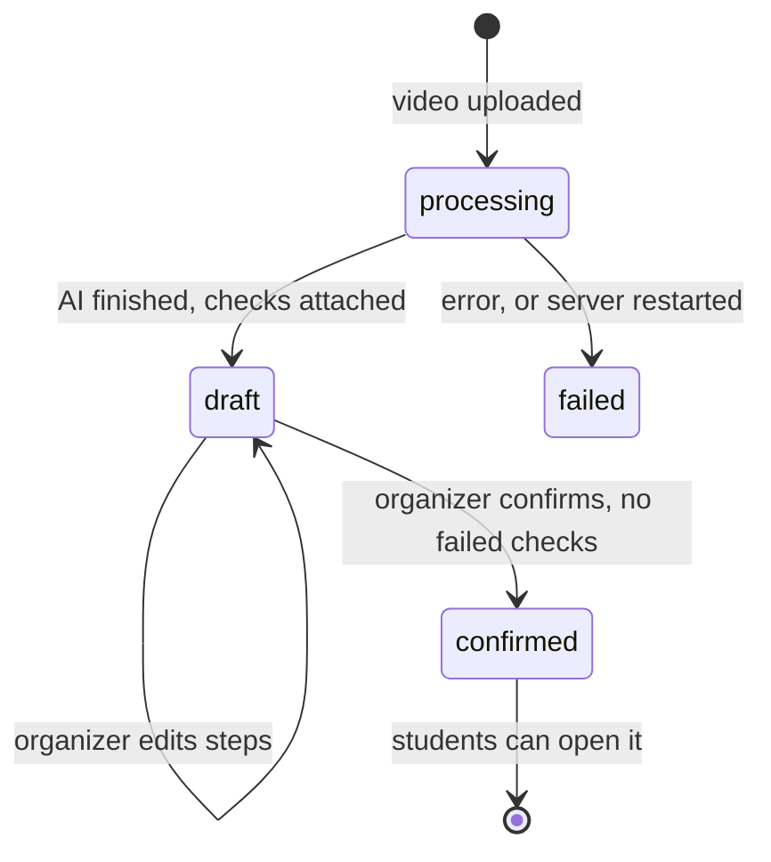
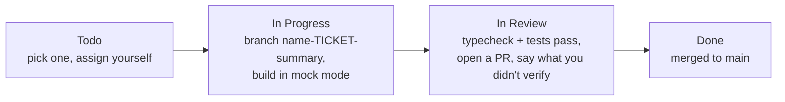
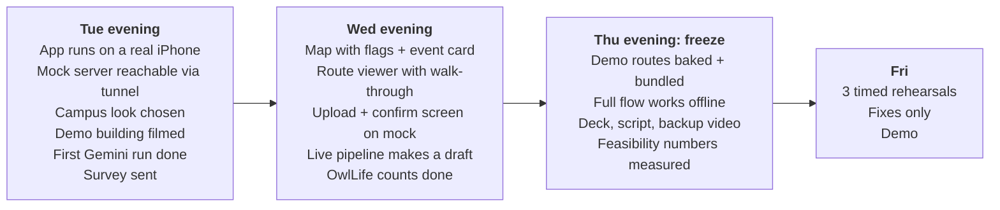

# KSU-GO

A 3D campus events app. Every event today is a flag on a stylized campus map. Tap a flag to see the event and register. Then follow a low-poly 3D route from the building entrance to the room door. That route is drafted by AI from one phone video an organizer films.

> **Heads up:** the run commands below work once S-1 (repo skeleton) and the first ticket in each part have landed. Until then the folders are empty.

| Read this | When |
|---|---|
| `SCOPE.md` | What we're building, the 5-minute demo, what's cut |
| `TICKETS.md` | The work, grouped by part |
| `CONTRACTS.md` | The shared formats every part must match |
| `AGENTS.md` | The rules your coding agent follows (and so do you) |
| `docs/pipeline.md` | Only for 🤖 AI + server tickets |

## How the app fits together



## Video to route



Only the 💳 steps cost money, and they only run in live mode on Juan's server. Everything else is plain code.

## Route status



Students only ever see `confirmed` routes.

## Life of a ticket



- **Todo:** take one ticket with nothing left in its **Blocked by** field (GitHub shows it as blocked on the board otherwise). **Done needs** tickets may still be open; build against fixtures and mock mode until they land. Have one in progress at a time, unless you are waiting on something.
- **In Progress:** create a branch like `yourname-APP-3-event-card`. Read the ticket and `CONTRACTS.md` first. Commit on your branch only.
- **In Review:** open the pull request. Self-merge is fine once the local type check and tests pass (there is no CI). Only `CONTRACTS.md` and `shared/types.ts` need a teammate's review.
- **Done:** merged. Move the card and grab the next one.

## The week at a glance



## Labels

| Label | Meaning |
|---|---|
| 📱 App | The Expo app (`app/`) |
| 🗺️ Campus map | The campus scene and the viewer build (`viewer/src/campus/`) |
| 🧭 Indoor route | The route scene and step instructions (`viewer/src/route/`) |
| 🤖 AI + server | The API and the video-to-route pipeline (`server/`) |
| 🎤 Pitch | Survey, event counts, slides, rehearsal (`pitch/`) |
| 🧱 Setup | Shared skeleton, types and fixtures |
| ✅ Must have | Needed for the demo |
| ✨ Bonus | Only after the must-haves it depends on work |
| 🚦 Do first | Start of Tuesday; others wait on it or it removes a big risk |
| 💳 Costs money | Makes paid API calls. Live runs happen on Juan's laptop, with his OK. |
| 🐛 Bug | Something broken |

## Mock vs live

| | Mock mode (default) | Live mode |
|---|---|---|
| Where it runs | Any laptop | Juan's laptop only |
| API keys | None | Gemini (and Replicate for the optional geometry step), Juan's only |
| Events, register, routes | ✅ | ✅ |
| Upload a video | ✅ returns a flawed sample draft after ~10 s | ✅ runs the real pipeline |
| Confirm screen, checks, edits | ✅ against the sample draft | ✅ against the real draft |
| Real AI timeline from your video | ❌ | ✅ 💳 |
| Cost | $0 | about $0.06 per route for Gemini, about $0.25 more with MapAnything |
| Who can start it | Anyone | Juan, or with Juan's OK |

The app also runs with **no server at all**, from bundled fixtures. It shows an "Offline data" badge when it does.

## How to run each part

**App** (`app/`)
```bash
cd app && npm install
npx expo start --tunnel     # or the setup in app/README.md that APP-1 found works from WSL
```
Scan the QR code with the iPhone camera, and the app opens in Expo Go. To point the app at a server, long-press the app title and paste the server address.

**Viewer** (`viewer/`): no phone needed.
```bash
cd viewer && npm install
npm run dev                 # open http://localhost:5173/?scene=campus or ?scene=route
npm run build               # rebuilds the single HTML file the app loads
```

**Server** (`server/`)
```bash
cd server && python -m venv .venv && source .venv/bin/activate && pip install -r requirements.txt
uvicorn main:app --reload   # mock mode, no keys needed
cloudflared tunnel --url http://localhost:8000   # optional: lets a phone on another network reach it
```

**Tests:** `npm run typecheck` in `app/`, `npm test` in `viewer/`, `pytest` in `server/`.

## How to grab a ticket

1. Open the board and pick a card in **Todo** that is not marked blocked (its **Blocked by** tickets are merged). Tickets marked 🚦 go first, then tickets with a long **Blocks** list. TICKETS.md explains the four dependency fields.
2. Assign yourself and move it to **In Progress**. One at a time, unless you are waiting on something.
3. Create a branch: `{your-name}-{ticket}-{short-summary}`.
4. Give your coding agent the ticket text. It reads `AGENTS.md` on its own, and the ticket plus `CONTRACTS.md` is all the context it needs.
5. Build and test in mock mode. Tests use recorded responses, never paid calls. If the ticket is 💳, live runs happen on Juan's laptop with his OK. If it lists "Pre-approved libraries", you can add those; ask before adding anything else.
6. Open a PR, move the card to **In Review**, and merge once the local type check and tests pass. Get a teammate's review only if you touched `CONTRACTS.md` or `shared/types.ts`.

Never put an API key anywhere in the repo, the app, an issue or a chat. If one leaks, tell Juan right away.
