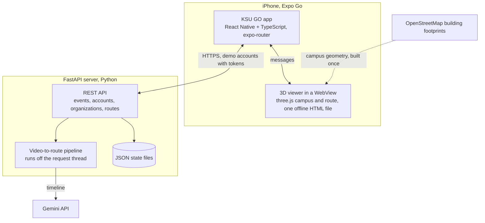
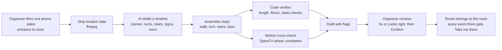
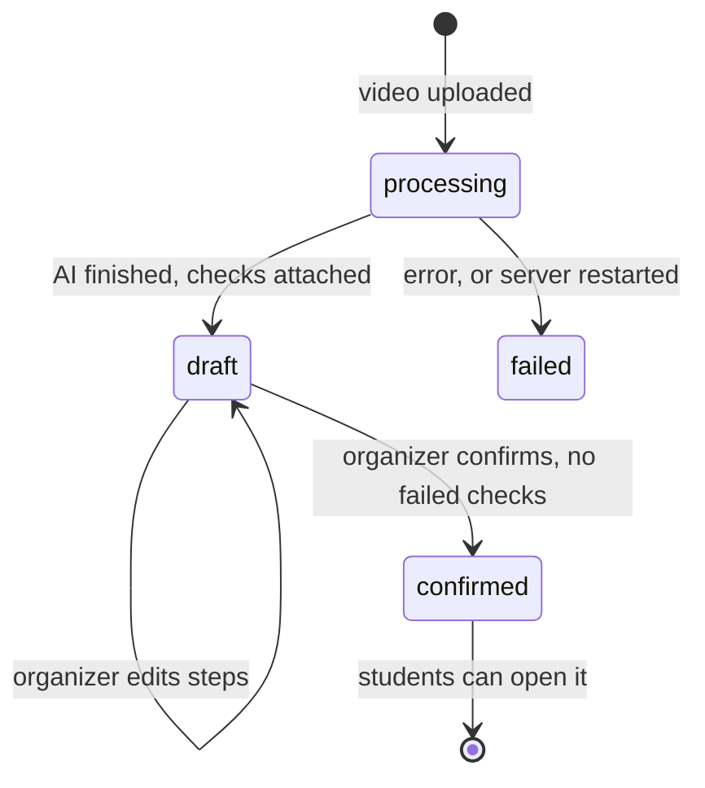
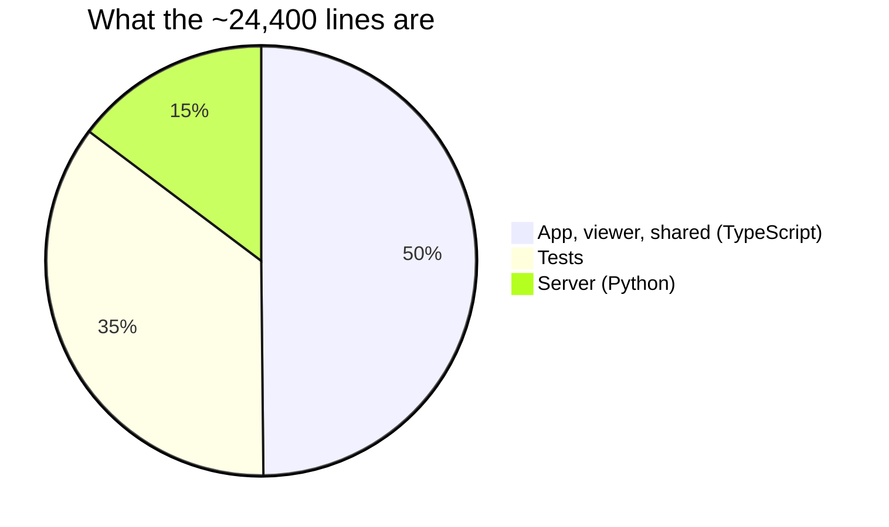
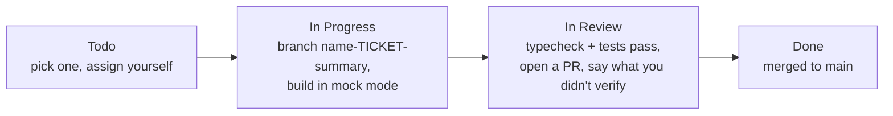
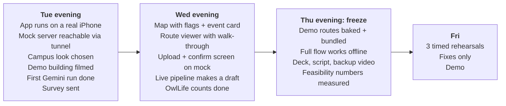

# KSU GO

**A campus events app for Kennesaw State that makes events easy to find, easy to reach and easy to run.** Students see today's events as flags on a 3D campus, browse a list or swipe through Discover, and register in a tap. Organizers manage their organization and create events. **Take me there** gives step-by-step directions from the building entrance to the room door. The route is drafted by AI from one phone video an organizer films, checked by code, and confirmed by the organizer before any student sees it.

Built in five days (November 16–20, 2026) for the KSU AI Club / IEEE-CS hackathon by Juan Castro, Chernoh Bah, Jorge Arriaga and David Henderson.

## Results (measured on campus, November 19–20, 2026)

| What | Result |
|---|---|
| Stairs route to Room 215 | Gemini's draft matched the hand-measured route exactly: 6 of 6 steps, room read as D215 |
| Motion check | 10 of 10 turn directions on four campus videos, 0 false alarms |
| Room 113, end to end | about 20 s upload + 39.8 s processing, about 5¢, 0 organizer corrections |
| Total AI spend for the project | $0.98 |
| Campus map on iPhone | steady 60 fps from one 777 KB offline file |
| Automated tests | 1,036 (app 148, viewer 109, shared 203, server 576) |

## Try it

- **No keys needed.** Everything runs in mock mode from fixtures; see [How to run each part](#how-to-run-each-part).
- **Demo accounts:** student Maya Chen (`student@ksu-go.example` / `StudentDemo!26`) and organizer Noah Brooks (`organizer@ksu-go.example` / `OrganizerDemo!26`).
- **Presentation:** [`pitch/KSU-GO-Presentation.pptx`](pitch/KSU-GO-Presentation.pptx), with a PDF copy alongside.

## How the app fits together



## Video to route



Gemini (`gemini-4-hydrogen`) watches the location-stripped video at 2 frames per second and returns a structured timeline. A route is stored as a short list of steps (about 2 KB), and the viewer draws the 3D directions from that list on the phone. MapAnything on Replicate was tested and cut: about $0.25 and 8 minutes per video, and its segments came back at different scales. Details are in [`docs/pipeline.md`](docs/pipeline.md).

## Route status



Students only ever see `confirmed` routes.

## What the code is



## Repo guide

| Read this | When |
|---|---|
| `SCOPE.md` | What we built, the 5-minute demo, what was cut |
| `TICKETS.md` | The work, grouped by part |
| `CONTRACTS.md` | The shared formats every part must match |
| `AGENTS.md` | The rules every coding agent follows (and so do we) |
| `docs/pipeline.md` | The video-to-route pipeline in detail |

## Life of a ticket



- **Todo:** take one ticket with nothing left in its **Blocked by** field (GitHub shows it as blocked on the board otherwise). **Done needs** tickets may still be open; build against fixtures and mock mode until they land. Have one in progress at a time, unless you are waiting on something.
- **In Progress:** create a branch like `yourname-APP-3-event-card`. Read the ticket and `CONTRACTS.md` first. Commit on your branch only.
- **In Review:** open the pull request. Self-merge is fine once the local type check and tests pass (there is no CI). Only `CONTRACTS.md` and `shared/types.ts` need a teammate's review.
- **Done:** merged. Move the card and grab the next one.

## The week at a glance



## Labels

| Label | Meaning |
|---|---|
| 📱 App | The Expo app (`app/`) |
| 🗺️ Campus map | The campus scene and the viewer build (`viewer/src/campus/`) |
| 🧭 Indoor route | The route scene and step instructions (`viewer/src/route/`) |
| 🤖 AI + server | The API and the video-to-route pipeline (`server/`) |
| 🎤 Pitch | Survey, event counts, slides, rehearsal (`pitch/`) |
| 🧱 Setup | Shared skeleton, types and fixtures |
| ✅ Must have | Needed for the demo |
| ✨ Bonus | Only after the must-haves it depends on work |
| 🚦 Do first | Start of Tuesday; others wait on it or it removes a big risk |
| 💳 Costs money | Makes paid API calls. Live runs happen on Juan's laptop, with his OK. |
| 🐛 Bug | Something broken |

## Mock vs live

| | Mock mode (default) | Live mode |
|---|---|---|
| Where it runs | Any laptop | Juan's laptop only |
| API keys | None | Gemini, Juan's only |
| Events, register, routes | ✅ | ✅ |
| Upload a video | ✅ returns a flawed sample draft after ~10 s | ✅ runs the real pipeline |
| Confirm screen, checks, edits | ✅ against the sample draft | ✅ against the real draft |
| Real AI timeline from your video | ❌ | ✅ 💳 |
| Cost | $0 | about 5–6¢ per route (Gemini) |
| Who can start it | Anyone | Juan, or with Juan's OK |

The app also runs with **no server at all**, from bundled fixtures. It shows an "Offline data" badge when it does.

## How to run each part

**App** (`app/`)
```bash
cd app && npm install
npx expo start --tunnel     # or the setup in app/README.md that APP-1 found works from WSL
```
Scan the QR code with the iPhone camera, and the app opens in Expo Go. To point the app at a server, long-press the app title and paste the server address.

**Viewer** (`viewer/`): no phone needed.
```bash
cd viewer && npm install
npm run dev                 # open http://localhost:5173/?scene=campus or ?scene=route
npm run build               # rebuilds the single HTML file the app loads
```

**Server** (`server/`)
```bash
cd server && python -m venv .venv && source .venv/bin/activate && pip install -r requirements.txt
uvicorn main:app --reload   # mock mode, no keys needed
cloudflared tunnel --url http://localhost:8000   # optional: lets a phone on another network reach it
```

**Tests:** `npm run typecheck` in `app/`, `npm test` in `viewer/`, `pytest` in `server/`.
